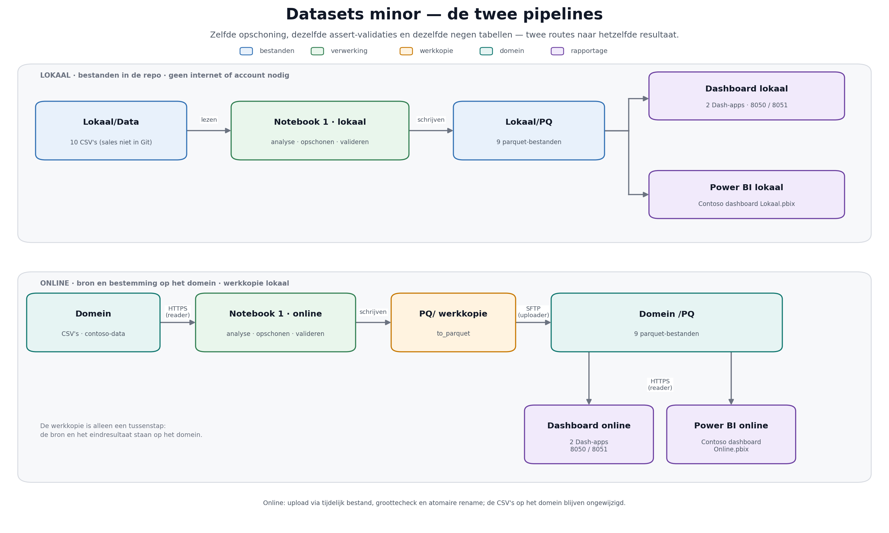

# Datasets minor

Analyse van de Contoso-retaildata: van ruwe CSV-bestanden naar opgeschoonde parquet-bestanden, met twee manieren van rapporteren — een Power BI-rapport en twee interactieve Dash-dashboards in Python. Beide rapportages gebruiken dezelfde parquet-bestanden (binnen één versie), zodat de cijfers op elkaar aansluiten (single source of truth).

De datasets zijn er in twee uitvoeringen:

- **Lokaal** — de analyse leest de CSV-bestanden uit `Lokaal/Data/` en schrijft de parquet-bestanden naar `Lokaal/PQ/`. Alle bestanden staan in deze repo; je hebt geen internet of account nodig.
- **Online** — de analyse downloadt de CSV-bestanden van het eigen domein (`https://kilometerapp.nl/contoso-data`) en uploadt de opgeschoonde parquet-bestanden terug naar dat domein. Het domein is de bron van de data; het notebook bewaart per bestand alleen een werkkopie op de machine waar het draait (in Google Colab onder `/content`, omdat de code dat pad gebruikt).

Beide versies doorlopen dezelfde stappen, dezelfde validaties en dezelfde negen tabellen. Kies één versie en houd die binnen een run bij elkaar: de online dashboards halen hun data van het domein, de lokale dashboards uit `Lokaal/PQ/`.

## De twee versies naast elkaar

| | Lokaal | Online |
|---|---|---|
| Analyse-notebook | `Lokaal/Data analyse Contoso lokaal.ipynb` | `Data analyse Contoso Online.ipynb` |
| Dashboard-notebook | `Lokaal/Dashboard lokaal.ipynb` | `Dashboard online.ipynb` |
| Power BI-rapport | `Lokaal/Contoso dashboard Lokaal.pbix` | `Contoso dashboard Online.pbix` |
| Brondata | `Lokaal/Data/*.csv` (in de repo) | CSV's van `https://kilometerapp.nl/contoso-data` |
| Resultaat | `Lokaal/PQ/*.parquet` | upload naar `/PQ` op het domein, plus een werkkopie in `PQ/` |
| Accounts | geen | lezer `contoso_reader` en uploader `contoso_uploader`, wachtwoord via prompt |
| Draait het lekkerst op | Windows met JupyterLab of VS Code | Google Colab (of een Linux-omgeving met schrijfbare `/content`) |
| Internet nodig | nee | ja |

## De pipelines in één beeld



- **Lokaal** loopt één richting op: de tien CSV's uit `Lokaal/Data/` gaan door notebook 1 en komen als negen parquet-bestanden in `Lokaal/PQ/`. Van daaruit lezen zowel de Dash-apps als het lokale Power BI-rapport. Geen internet of account nodig.
- **Online** gaat heen en terug: dezelfde CSV's komen per HTTPS van het domein (lezer-account), notebook 1 schrijft de parquet naar de werkkopie `PQ/`, en die gaan per SFTP (upload-account) naar `/PQ` op het domein. De online dashboards én het online Power BI-rapport halen de parquet daarna weer van het domein.
- **Rapportage** leest nooit CSV's: beide Dash-apps en beide Power BI-rapporten werken op dezelfde negen parquet-bestanden, binnen één versie.

De afbeelding komt uit `docs/pipeline.py`; dat script genereert `docs/pipeline.png` opnieuw (matplotlib staat in `environment.yml`).

## Bestandsstructuur

```
Datasets minor/
├─ Lokaal/                                lokale versie
│  ├─ Data/                               ruwe bronbestanden (Contoso-CSV's + GDP per capita van de Wereldbank)
│  ├─ PQ/                                 opgeschoonde data als parquet (output van de lokale analyse)
│  ├─ Data analyse Contoso lokaal.ipynb   notebook 1: analyse → opschonen → valideren → parquet
│  ├─ Dashboard lokaal.ipynb              notebook 2: grafieken en twee Dash-dashboards
│  └─ Contoso dashboard Lokaal.pbix       Power BI-rapport op de lokale parquet-bestanden
├─ PQ/                                    parquet van de online pipeline (werkkopie)
├─ Data analyse Contoso Online.ipynb      notebook 1: download CSV → opschonen → valideren → upload parquet
├─ Dashboard online.ipynb                 notebook 2: grafieken en twee Dash-dashboards
├─ Contoso dashboard Online.pbix          Power BI-rapport op de online parquet-bestanden
├─ environment.yml                        conda-omgeving met alle benodigde packages
├─ docs/                                  pipeline-diagram (png + generator)
└─ README.md
```

| Notebook | Doel | Leest | Schrijft |
|---|---|---|---|
| `Lokaal/Data analyse Contoso lokaal.ipynb` | Alle datasets analyseren, opschonen en valideren | `Lokaal/Data/*.csv` | `Lokaal/PQ/*.parquet` |
| `Lokaal/Dashboard lokaal.ipynb` | De Power BI-visualisaties namaken en combineren tot Dash-dashboards | `Lokaal/PQ/*.parquet` | — (grafieken en webapps) |
| `Data analyse Contoso Online.ipynb` | Alle datasets analyseren, opschonen en valideren | CSV's van het domein | parquet naar `/PQ` op het domein + werkkopie in `PQ/` |
| `Dashboard online.ipynb` | De Power BI-visualisaties namaken en combineren tot Dash-dashboards | parquet van het domein | — (grafieken en webapps) |

De notebooks bevatten opgeslagen output, dus je kunt de resultaten ook bekijken zonder ze te draaien. Wil je zelf iets aanpassen of de data verversen, draai ze dan in de volgorde hieronder.

## Vereisten

- Miniconda of Anaconda (of een eigen Python 3.14-omgeving met de packages uit `environment.yml`)
- JupyterLab of VS Code met de Jupyter-extensie
- Power BI Desktop (alleen nodig voor de `.pbix`-bestanden, Windows)
- Ongeveer 1 GB vrije schijfruimte: de sales-CSV is circa 200 MB, elk Power BI-rapport circa 66 MB en de parquet-bestanden samen circa 50 MB per versie
- Voor de online versie: internet, een lezer- en uploadaccount voor het domein, en Google Colab of een Linux-omgeving met een schrijfbare `/content`

## Omgeving klaarzetten

```bash
conda env create -f environment.yml
conda activate contoso
```

`environment.yml` bevat de packages voor de analyse, de dashboards en de online pipeline (pandas, numpy, pyarrow, matplotlib, seaborn, plotly, dash, squarify, requests, paramiko), maar geen volledige JupyterLab-installatie. Kies een van deze twee werkwijzen:

```bash
# Optie A: JupyterLab in de omgeving installeren
pip install jupyterlab
jupyter lab
```

```text
Optie B: open de notebooks in VS Code met de Jupyter-extensie
         en kies als kernel de Python van de omgeving "contoso".
```

Voor de online notebooks hoef je lokaal niets klaar te zetten: open ze in Google Colab en draai eventueel de eerste cel, waarin als commentaar een `%pip install -q ... requests paramiko` klaarstaat. De omgeving van Colab bevat de packages meestal al.

Let op:

- De notebooks staan opgeslagen met de kernel `contoso`; die naam zie je in de kernel-kiezer. Ontbreekt hij, kies dan de Python van de zojuist aangemaakte omgeving.
- Start JupyterLab **in de map van de versie die je draait**: voor de lokale notebooks is dat `Lokaal/`, voor de online notebooks de hoofdmap. De lokale notebooks gebruiken relatieve paden (`Data\...`, `PQ\...`), dus vanuit een andere map worden de bestanden niet gevonden.
- De online notebooks schrijven elke download eerst naar de schijf van de machine waar ze draaien, standaard onder `/content/contoso/`; dat is het pad dat de code gebruikt en dat in Google Colab bestaat. Het is een werkkopie, geen opslaglocatie: de bestanden staan op het domein. Op Windows of macOS bestaat `/content` niet (het wordt daar `C:\content`) en is de schijfwortel meestal niet schrijfbaar; pas dan het pad in `load_data` aan of gebruik de lokale versie.
- Packages toevoegen? Werk `environment.yml` bij met `conda env export --from-history > environment.yml`, zodat een ander de omgeving opnieuw kan opbouwen.

## Data: wat zit er wel en niet in de repo

- **`Lokaal/Data/Contoso_Sales.csv` (± 208 MB)** staat niet in Git (zie `.gitignore`), omdat het bestand te groot is. Het is wel nodig voor de lokale analyse: zonder dit bestand stopt het notebook bij het inlezen. Vraag het bestand op bij de eigenaar van de repo of haal het uit de originele bron.
- **De overige CSV-bestanden in `Lokaal/Data/`** zitten wel in Git, net als de notebooks en `environment.yml`.
- **De parquet-bestanden in `Lokaal/PQ/` en `PQ/`** zitten in de repo als momentopname van een eerdere run. Een nieuwe run overschrijft ze op schijf, maar zet ze niet vanzelf in Git; committen is handwerk. Draai notebook 1 om ze te verversen.
- **Online** staan de CSV's en de parquet-bestanden op het domein, achter de lezer-account (`contoso_reader`). De map `PQ/` in de repo is de werkkopie die de upload-functie vóór het uploaden wegschrijft; het is geen tweede bron, maar dezelfde data als op het domein. Alleen de parquet-bestanden worden teruggezet; de CSV's op het domein blijven de onveranderde brondata.
- Let op bij een verse clone: controleer of `Contoso dashboard Lokaal.pbix` en `Contoso dashboard Online.pbix` (elk ± 66 MB) en `environment.yml` aanwezig zijn. Ontbreekt een daarvan, vraag het bestand dan op bij de eigenaar van de repo.

## Snelstart lokaal

De notebooks bouwen op elkaar voort: notebook 2 heeft de parquet-bestanden van notebook 1 nodig.

1. Start JupyterLab in `Lokaal/` (of open die map in VS Code).
2. Open `Data analyse Contoso lokaal.ipynb` en kies **Run All** (in VS Code: **Run All Cells**). Het notebook leest de CSV's uit `Data/`, schoont ze op, valideert ze en schrijft negen parquet-bestanden naar `PQ/`. Dit duurt een paar minuten.
3. Open `Dashboard lokaal.ipynb` en kies opnieuw **Run All**. Het notebook leest de parquet-bestanden en bouwt de grafieken en de twee dashboards.
4. Optioneel: open `Contoso dashboard Lokaal.pbix` in Power BI Desktop en ververs het rapport (zie [Power BI](#power-bi)).

## Snelstart online

De online pipeline werkt in de omgekeerde richting: eerst van het domein af, daarna weer naar het domein toe. De volgorde is belangrijk, want de rapportage leest wat de analyse heeft geüpload.

1. Open `Data analyse Contoso Online.ipynb` in Google Colab (of een omgeving met een schrijfbare `/content`).
2. Draai de eerste codecellen. Je wordt één keer om een wachtwoord gevraagd: dat van het lezersaccount `contoso_reader`, waarmee de CSV's worden gedownload. Het wachtwoord wordt niet opgeslagen.
3. Kies **Run All**. Het notebook downloadt de CSV's naar de werkkopie `/content/contoso/data/`, schoont ze op en valideert ze.
4. De laatste cel vraagt om het wachtwoord van het uploadaccount `contoso_uploader` en zet de negen parquet-bestanden op de server. Daarbij wordt eerst een werkkopie in `PQ/` gezet, daarna een tijdelijk bestand geüpload, de bestandsgrootte gecontroleerd en het bestaande bestand atomair vervangen. Je ziet per bestand een regel `Succesvol geüpload: ...`.
5. Open `Dashboard online.ipynb` en kies **Run All**. Het notebook vraagt opnieuw om het wachtwoord van het lezersaccount en downloadt de zojuist geüploade parquet-bestanden naar de werkkopie `/content/contoso/PQ/`.
6. Optioneel: open `Contoso dashboard Online.pbix` in Power BI Desktop en ververs het rapport; het haalt de parquet van het domein (zie [Power BI](#power-bi)).

Let op:

- De uploadcel gaat uit van een `known_hosts`-bestand met de hostkey van de server (`ssh.load_host_keys(...)` met `RejectPolicy`). Ontbreekt die hostkey, dan stopt de upload met een fout over de host key; voeg de hostkey dan toe aan `~/.ssh/known_hosts`.
- De servergegevens staan boven de upload-functie in het notebook (`HOST`, `USER`, `REMOTE_DIR`). Pas die alleen aan als de omgeving verandert.
- De prompts zeggen "SFTP-wachtwoord", maar bij het downloaden gaat het om het lezersaccount voor de HTTPS-downloads.

## 1. Data-analyse

Beide analyse-notebooks zetten de ruwe data om in een opgeschoonde, gevalideerde dataset per tabel. De secties zijn identiek:

| Sectie | Onderwerp |
|---|---|
| 0 | Libraries en de hulpfunctie `init_analyse` |
| 1 | Sales |
| 2 | Product |
| 3 | Calendar |
| 4 | Geography |
| 5 | Stores |
| 6 | Promotions |
| 7 | Product (sub)category |
| 8 | Channel |
| 9 | GDP per capita (Wereldbank) |
| 10 | Integrale validatie tussen de datasets |
| 11 | Opslaan als parquet (lokaal) of uploaden (online) |

Elke dataset doorloopt dezelfde stappen: inlezen → eerste analyse met `init_analyse` (datatypes, duplicaten, lege waarden, unieke waarden, eerste en laatste rijen) → constateringen opschrijven → opschonen → valideren met `assert`.

Aandachtspunten:

- Draai de cellen van boven naar beneden. Cellen gebruiken variabelen uit eerdere cellen (zoals `sales_df2`, `productmerge_df` en `productcat_df`), dus losse cellen draaien werkt niet.
- De hulpfunctie `init_analyse` staat in cel 2 van het notebook; een losse `shared.py` is niet nodig.
- De validaties zijn bewust streng. Verandert de brondata, dan stopt het notebook met een `AssertionError` in plaats van stilletjes met andere cijfers verder te gaan. De foutmelding noemt de regel en het probleem.
- `sales_df2` (met de correcties op retouren en kostprijs) is de dataset die wordt opgeslagen en verder gebruikt; het originele `sales_df` blijft als controle bewaard.
- Sectie 11 verschilt per versie. Lokaal schrijft die sectie de bestanden naar `Lokaal/PQ/`; online staan die `to_parquet`-regels als commentaar en doet de uploadcel het werk. Draai je die sectie niet, dan werken notebook 2 en Power BI niet met je nieuwe data.
- Online downloadt `load_data` elk bestand naar een werkkopie onder `/content/contoso/` en leest het daar in; dat pad staat hardcoded in de code, vandaar de Colab-aanname. `upload_parquet` schrijft eerst een werkkopie naar `PQ/`, maar dat pad is relatief aan de werkmap van de kernel: in Colab wordt dat `/content/PQ`, draai je het notebook vanuit de hoofdmap van de repo dan is dat de map `PQ/` in de repo. Daarna gaat het bestand pas via SFTP naar de server.
- Let op de spelling van het GDP-bestand: de lokale versie gebruikt `Contose_GDP.parquet` (zonder t, een historische spelfout die in beide lokale notebooks consistent is), de online versie `Contoso_GDP.parquet`.

## 2. Dashboard

Beide dashboard-notebooks bouwen de visualisaties uit het Power BI-rapport na in Python.

**2.1 Sales Dashboard**

- KPI's: revenue, cost, gross margin en gross margin % (GSM-01)
- Revenue over time (GSM-02)
- Revenue by channel (GSM-04)
- Revenue by product category (GSM-05)
- GDP per capita versus revenue (GSM-03)

**2.2 Product portfolio Dashboard**

- KPI's, inclusief sales quantity in plaats van cost
- Revenue by product category (PPM-01)
- Revenue change versus vorig jaar in % (PPM-04)
- Top 10 producten op revenue (PPM-02)
- Cost by manufacturer (PPM-05)
- Gross margin versus sales quantity (PPM-03)

Elke visualisatie wordt eerst los opgebouwd — een cel met het dataframe, daarna een cel met de Plotly-grafiek — en daarna samengevoegd tot een interactief Dash-dashboard met slicers voor jaar, maand, land, continent, kanaal en productcategorie. Drilldowns en invoerknoppen uit Power BI zijn bewust weggelaten: het doel is aantonen dat dezelfde analyses in Python kunnen, niet Power BI vervangen.

Het enige verschil tussen de twee notebooks zit bovenaan: de lokale variant leest de parquet-bestanden uit `PQ/`, de online variant downloadt ze bij aanvang van het domein (en vraagt daarvoor het wachtwoord van het lezersaccount).

### De dashboards starten

De laatste cel van elk dashboard start de webapp:

| Dashboard | Startcommando in | Poort | URL |
|---|---|---|---|
| Sales Dashboard | cel `salesdashboard.run(...)` | 8050 | <http://127.0.0.1:8050> |
| Product portfolio | cel `portfoliodashboard.run(...)` | 8051 | <http://127.0.0.1:8051> |

- Standaard toont Dash de app **inline** in de celoutput van het notebook. Wil je hem in een eigen browsertab, gebruik dan bijvoorbeeld `salesdashboard.run(debug=False, port=8050, jupyter_mode="tab")`.
- Door de verschillende poorten kunnen beide dashboards naast elkaar draaien. Start ze in aparte cellen en wacht tot de eerste app draait voordat je de tweede start.
- Blijft een cel hangen of verschijnt er niets, zet dan `debug=False`. De reloader van `debug=True` werkt niet altijd goed samen met een notebook-kernel. Een andere veelvoorkomende oorzaak is een poort die al in gebruik is ("Address already in use"); kies dan een andere poort.
- Stoppen: onderbreek de cel (■) of herstart de kernel. Na een herstart moet je de cellen opnieuw draaien, inclusief het inlezen van de parquet-bestanden bovenaan.

## Power BI

Er zijn twee rapporten met dezelfde inhoud, maar een andere databron:

| Rapport | Hoort bij | Databron |
|---|---|---|
| `Lokaal/Contoso dashboard Lokaal.pbix` | de lokale pipeline | de map `Lokaal/PQ/` (mapconnector) |
| `Contoso dashboard Online.pbix` | de online pipeline | `https://kilometerapp.nl/contoso-data/PQ/*.parquet` (HTTPS, lezer-account) |

- Het model is een importmodel: de parquet-bestanden worden ingelezen en de data wordt in het rapport opgeslagen. Je kunt een rapport dus openen en bekijken zonder de bron, maar voor verversen heb je die nodig.
- Het lokale rapport leest de map `Lokaal/PQ/` via een mapconnector. Het pad staat in het rapport en verwijst naar de map op de computer waar het rapport is gemaakt; staan de bestanden ergens anders, pas het pad dan aan in Power Query (query's `Sample file` / `Transform file` → `Folder.Files(...)`) of via **Gegevensbronnen wijzigen**.
- Het online rapport haalt de parquet rechtstreeks van het domein, met het lezer-account `contoso_reader`. Je hoeft daarvoor geen lokale bestanden bij te werken: na het draaien van de online analyse (die naar `/PQ` uploadt) volstaat **Start → Vernieuwen**. Bij het verversen vraagt Power BI om de inloggegevens van dat account. Verandert het domein of het pad, pas dan de URL aan in Power Query.
- De repo-map `PQ/` is voor het online rapport dus niet nodig; die is alleen de werkkopie die de upload-functie wegschrijft.

## Veelvoorkomende problemen

| Probleem | Oorzaak en oplossing |
|---|---|
| `FileNotFoundError: Data\Contoso_Sales.csv` | De sales-CSV ontbreekt in de repo; zie [Data](#data-wat-zit-er-wel-en-niet-in-de-repo). |
| `FileNotFoundError: PQ\...parquet` | Notebook 1 is nog niet (volledig) gedraaid, of je bent niet in de juiste map begonnen; draai eerst `Data analyse Contoso lokaal.ipynb` vanuit `Lokaal/`. |
| `FileNotFoundError: ...Contose_GDP.parquet` | Spelfout in de bestandsnaam: de lokale versie gebruikt `Contose_GDP.parquet`, de online versie `Contoso_GDP.parquet`. Gebruik de notebookversie die bij je data hoort. |
| `401 Client Error` of `Authentication failed` bij downloaden | Verkeerd wachtwoord of verkeerd account; je krijgt per notebook één prompt voor het lezersaccount. |
| `Authentication failed` bij uploaden | Verkeerd wachtwoord voor `contoso_uploader`, of het account heeft geen schrijfrechten op `/PQ`. |
| `ModuleNotFoundError` | Verkeerde kernel of omgeving; activeer `contoso` en kies die kernel in het notebook. Ontbreekt `paramiko` of `requests`, werk dan de omgeving bij. |
| Upload stopt met een fout over de host key | De hostkey van de server staat niet in `~/.ssh/known_hosts`; voeg hem toe en probeer opnieuw. |
| `FileNotFoundError` of `PermissionError` onder `/content` | De online notebooks gaan uit van Google Colab; draai ze daar of pas `Path("/content/contoso")` in `load_data` aan. |
| `AssertionError` in notebook 1 | De brondata wijkt af van de verwachtingen; lees de foutmelding, die noemt de regel en het probleem. |
| Dash toont niets of de cel blijft draaien | Zet `debug=False`, controleer of de poort vrij is, of gebruik `jupyter_mode="tab"`. |
| Power BI vindt de parquet-bestanden niet | Lokaal: het mappad in Power Query klopt niet. Online: de URL of de inloggegevens van het lezer-account kloppen niet; controleer beide. |
| Verouderde cijfers in Power BI | Het rapport is niet ververst, of de nieuwe parquet is niet geüpload; draai notebook 1 (online inclusief de uploadcel) en kies **Start → Vernieuwen**. |
